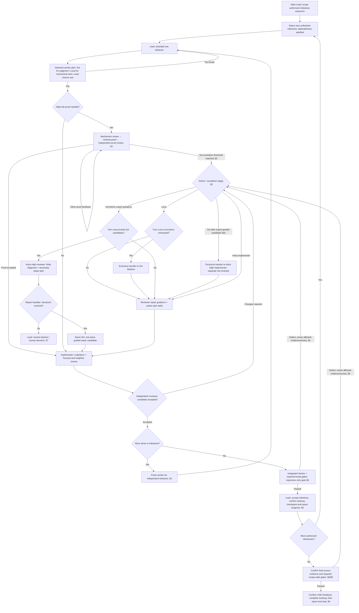

# Codex Specification Implementation

Complete all remaining authorized milestones in one continuous run, one milestone and behavior at a time. Deliver behavior, evidence, and independent acceptance; respect explicit user boundaries and the pause rules.

## 1. Roles and authority

The main conversation agent is the single Lead. It owns scope, decomposition, coordination, user communication, progress checks and acceptance; do not spawn a separate Lead or supervisor.

| Role | Owns | Model / configuration |
|---|---|---|
| Lead (main agent) | Scope, slicing, dependencies, progress, blockers, user decisions, acceptance, stop boundary | Existing main conversation; not spawned |
| Implementer (default) | Plan, tests, code, affected docs, verification | `sol_worker`, fixed `gpt-6.1-sol` / `medium` |
| Mechanical implementer | Bounded mechanical edits with straightforward acceptance criteria | `luna_worker`, fixed `gpt-6-luna` / `max` |
| Escalated implementer | Remaining work after Luna (§5), or when its task needs broader implementation judgment | `sol_worker`, fixed `gpt-6.1-sol` / `medium` |
| Independent reviewer | High-risk mechanism/proof and substantive candidate review | `default`, `gpt-6.1-sol`, `medium` |
| Expert reviewer | Bounded diagnosis and necessary-change repair plan after two unsuccessful Sol candidates (§5) | `default`, `gpt-6-astra`, `high` |
| Final escalated implementer | Remaining behavior after Sol's Astra-guided repair fails (§5) | `default`, `gpt-6-astra`, `high` |

- Default to `sol_worker` for implementation requiring judgment. Apply §3's worker-selection check before each new implementer dispatch; select `luna_worker` for eligible mechanical work and record the reason in the existing brief/status.
- Sol-first behaviors enter the Sol stage directly, without a preliminary Luna budget. If a Luna task needs broader design judgment, integration, or difficult debugging, transfer exclusive ownership to `sol_worker` at a safe handoff without exhausting the Luna budget; preserve source, evidence, findings and all unsuccessful counts.
- Subagents use `fork_turns: "none"`; default agents use the table's model/effort. If required roles/capabilities are unavailable, report and obtain a fallback choice before substitution.
- Lead spawns at most one active implementer and one independent reviewer; slices run sequentially. No further delegation by workers/reviewer, nested leads, extra supervisor, or extra worktrees/databases merely to fill slots.
- Lead may inspect source/evidence, resolve routine decisions and edit prose/tracking; **no application/test/migration/build/runtime/script edits**, including small fixes or code conflict resolution. Explicit skill editing is exempt. Reviewer is read-only, never accepts its own implementation, and substantive blockers cannot be waived by Lead.
- Replacement author takes exclusive ownership after the former author stops editing; never overlap Luna/Sol/Astra writers. Expert diagnosis uses the independent reviewer slot, not another supervisor. Same-reviewer rules below permit only the explicit §5 expert handoff; nobody reviews their own implementation.
- Work through all remaining milestones in the approved scope during one run, sequentially in the plan's dependency order. A request to implement the approved plan authorizes continuation between its milestones; an explicit milestone/range/stop limit takes precedence. Keep the same main Lead throughout the run, including compaction. Lead handles in-scope blockers and progress checks (§7), without duplicate routine reviews or command polling. Ask the user only for unresolved material requirement/scope/authority conflicts or actual capability blockers. No commit, publish, deploy, usage reset, or paid-setting change beyond existing authority.

## 2. Resume and tracking

Resolve the spec directory and read applicable repo instructions. Lead reads governing scope/acceptance/stop requirements and the relevant spec, source and build/test details. Ask only for unresolved target/material requirements. Preserve exact step names, dependencies, existing edits, accepted decisions and valid verification.

| File | Exclusive owner | Contents |
|---|---|---|
| `progress.md` | Lead | Accepted milestones, durable decisions, historical evidence links and pause/completion handoffs. No worker diary or duplicate live state. |
| `status.md` | Lead | Authorized run scope and milestone sequence (accepted/current/pending), current objective and slice sequence/brief, decisions, agent IDs/ownership, behavior records/findings (§5), blockers, execution agreement, next action/evidence and run progress-check record (§7). Replace stale state; aim ~60 lines, necessary facts take priority. |

Create missing tracking files for implementation, not skill discussion/editing. Keep live state in status and accepted outcomes in progress; link evidence rather than copying histories. Checkpoint meaningful changes and before planned pause/handoff. No simultaneous writers.

On resume/compaction, read status and relevant progress decisions; reconcile with newer user instructions and verify relevant current source/evidence. Continue the unfinished milestone, or select the next pending authorized milestone if the previous one is accepted. Preserve valid accepted work, unresolved behavior counts/escalation stages, cleanup obligations and run deadlines. Tracking never overrides requirements. Retrieve history only for a concrete gap; do not reload everything or rerun valid gates. Reopen settled decisions only for new instructions or evidence of invalidity; record why. When resuming older single-milestone tracking, derive remaining scope from the current user authorization and approved plan; a previously explicit single-milestone limit still applies. Resuming a supervised pause requires explicit user direction (§7).

When resuming the former two-coordinator workflow, obtain a finite handoff from any active delegated coordinator and end its coordination role before taking ownership. Preserve child IDs, findings, attempts, execution/cleanup obligations and check deadlines; reuse existing children when supported. Do not duplicate writers or interrupt active commands blindly. If child control cannot transfer safely, report the capability blocker rather than keeping two permanent coordinators or spawning replacements over active work. Move the current check record to status once; preserve historical progress entries.

## 3. Dispatch and slicing

Lead identifies the authorized run scope: all remaining milestones when asked to implement the approved specification/plan, or the narrower milestone/range explicitly requested. Record the exact milestone sequence, dependencies, scope/exclusions and acceptance/stop conditions in status. Merely referencing a broader specification does not expand a narrow assignment. Lead owns decomposition and dispatches workers directly; no extra managerial approval stage.

**Milestone loop:** Select the first unfinished authorized milestone in the approved dependency order. Complete its behavior slices, independent acceptance, required integration gates and cleanup before advancing (§8). At acceptance, checkpoint the outcome, report a concise progress update and automatically select the next pending milestone whose dependencies are satisfied; no new user confirmation or main conversation is required. If a dependency is missing outside the authorized scope, resolve the material scope decision before dependent work; do not skip the blocked milestone or mark it complete. Milestone acceptance is a continuation boundary; run completion, explicit user stops and the existing pause/blocker rules are stopping boundaries.

**Size implementation work before dispatch:** Lead inspects actual source/dependencies and assigns one independently verifiable behavior at a time, not an entire numbered milestone by default. Give that acceptance target a stable behavior ID (§5); slice/worker names do not define its retry budget. Each brief names the outcome, governing contracts/existing patterns, owned scope/exclusions, decisive acceptance scenarios, focused checks, and consuming integration/remaining work. In the existing brief/status, record the sizing decision in one sentence: fits as one behavior, split into dependent slices, or inseparable coupled mechanism with reason.

Split when independent mechanisms need separate design decisions (e.g. codec, quota lifecycle, expiry, publication races), or unrelated scenario families prevent one clear acceptance boundary. Keep a transaction and its atomic effects, rollback, authorization, and necessary shared-contract changes together; do not separate quota reservation from the session mutation it protects. Size by behavior and dependencies, not files, layers, time caps, or a rigid test count. Avoid tiny slices that duplicate setup/review without isolating a behavior. A small slice can still be high-risk and must follow §4; sizing does not change the model/escalation rules (§1/§5). No scaffolding-only slices, speculative interfaces, scope expansion, or skipped gates.

**Worker selection — required before each new implementer dispatch:** Assess the whole assignment, including verification and consumer integration. Select `luna_worker` when the acceptance criteria and implementation approach are fixed, existing patterns cover the changes, and no unresolved design, API, behavior or difficult debugging decisions remain. Typical eligible work includes specified presentation wrappers, copy/localization updates and repetitive wiring to established contracts. Routine consumer integration or required tests/browser proof alone do not disqualify Luna.

Select `sol_worker` when the assignment needs new mechanism/API design, financial or async/focus lifecycle decisions, nontrivial integration judgment, or diagnosis of an uncertain cause. Small size or first-pass success does not establish mechanical scope. Record one sentence in the existing brief/status: `worker + model/effort | why Luna is eligible, or which concrete requirement needs Sol`; the Sol default alone is not a selection reason. Apply this check to separately assigned verification too. Corrections retain the current author/escalation stage under §5. Preserve coupled behaviors; do not split work merely to use Luna or impose a worker quota.

Keep the same main Lead for the run, one active implementer, and the same independent reviewer subject to §5's expert handoff rules; milestones and slices run sequentially. Preserve established contracts, source/evidence and unresolved attempt counts (§5) when splitting, advancing milestones or resuming. Choose worker context using the boundary rule below, including at milestone transitions. No extra planner, managerial approval stage, or per-slice document.

**Worker context at slice boundaries:** A new independently scoped behavior gets a fresh worker with `fork_turns: "none"`; do not wait for compaction or carry a completed behavior's conversation into new work. Corrections, proof revisions and verification of the same behavior reuse its current author while available. A separately assigned integrated verification task also gets a fresh worker; a discovered defect routes to the appropriate behavior author under §5. Returning/interrupting does not clear context: implement a fresh context through replacement, never claim an in-place reset. No refresh during active execution/review and no reset of unresolved attempts or escalation stage; an escalated behavior never returns to Luna (§5).

Before replacement, obtain the former worker's final checkpoint and confirm its turn ended with no active command/restoration obligation. Retain the same reviewer. Supply only relevant source/contracts, accepted evidence, unresolved findings/counts, execution agreement and remaining integration; no inherited transcript, repeated valid gates or extra handoff document. Record exclusive ownership in status. Check capacity only at this boundary: preserve room for the independent reviewer and the applicable Sol/Astra transfer. Returned agents may still occupy capacity; expert transfer must also fit before dispatch. Retire a stopped worker only using an actually exposed supported tool; idle/interrupted does not imply a freed slot. If capacity cannot support replacement, checkpoint and report the limitation for a user fallback decision before starting the new behavior; do not silently reuse old context, exceed limits or replace the reviewer to free a slot.

**Implementer lifecycle — include in every worker brief:** At an agreed proof/candidate/verification handoff, finish owned commands and cleanup, return `outcome | source/evidence | open findings/effort | cleanup/remaining obligations | next action/owner`, then end the turn. Do not send “ready” and wait for review, acknowledgment or another assignment. This is a finite handoff, not acceptance or permission to expand scope. Mid-assignment blocking decisions still follow §3's ownership rule; do not return after every command or abandon handles. Lead uses `send_message` for active-work steering and `followup_task` on the SAME returned worker for corrections/continuation of that behavior. New independent work follows the fresh-context rule above. Never reactivate solely to acknowledge a final result. Missing reactivation/lifecycle capabilities follow §1; do not invent close/reset tools.

**Focused handoffs (all roles):** Supply assigned outcome/requirement IDs with exact spec sections; owned components/files and shared resources; dependencies/exclusions; inputs/outputs/errors/effects and shared contracts; relevant evidence, missing scenarios, unresolved findings/repair guidance, next artifact, verification, and remaining integration. Link source documents with section/function/test locations; quote only essential constraints. Do not paste entire specs, project handbooks, conversations, or completed finding histories. Recipients read applicable instructions and referenced requirements; retrieve more source/context for concrete dependencies or uncertainties. Preserve required workflow rules below, acceptance criteria, attempt counts, and ownership/restoration obligations. No arbitrary context cap or separate handoff document. Corrections to the same agent carry changed scope/source, unresolved findings, new evidence, and plan delta; fresh replacements receive the complete relevant assignment state.

**Workflow map:** Read as text; no rendering step needed. Roles/models/effort: §1. This overview does not replace detailed rules; §4 governs proof, §5 candidate counting, §6 verification, and §7 progress checks/pause at every stage.

When Luna is selected, its candidate budget is: initial submission + up to four corrections (five attempts total); explicit inability also follows §5. Early-proof feedback is separate from Luna candidate counting. Sol-first work starts at the Sol stage; Sol/Astra stages and proof-level candidate accounting follow §5. Lead verifies that slices compose into the milestone; slice review is not final acceptance. For a single slice, the boundaries coincide. Preserve any repo/plan-required earlier gates.

Outside proof/candidate checkpoints, workers act autonomously; no permission per edit/test/RED/run. Serialize conflicting fixtures, build outputs, databases, ports, and servers without repeated test-slot transfers.

Every brief states role, ownership, governing paths, shared workspace/preserve-others rule, and applicable workflow. Lead reads this skill. Workers receive plan/proof, repair-guidance use, review-before-broad-gates, attempt, pause, communication route below, and §6 execution agreement/ownership/stall rules (batched notice, autonomous repairs/runs/handle resumes, five-minute check, one recovery) explicitly. Worker briefs include §4's local-stall diagnostic and §6's end-of-behavior effort summary; documentation/release-verification briefs also include §4's evidence-first check. Reviewer briefs include §5's repair guidance and finite-request/return lifecycle. All briefs include §6's minimum-evidence/gate-ownership rule and concise-output practice: retain verbose logs, return result/evidence links and relevant failure excerpts, retrieve further output for a concrete gap. **Every worker/reviewer/escalation brief includes §6's waiting rule verbatim; Lead obeys it too**. Paths alone do not transmit rules to fresh contexts.

**Actionable notifications:**

| Route | Notify for |
|---|---|
| Worker → Lead | Required plan/delta, review-ready proof/candidate, blocker/decision, slice execution agreement or material change, execution blocker (§6), completed verification |
| Lead → user | Meaningful progress, accepted milestone, stopping boundary, pause or decision/capability blocker needing user action |
| Lead → reviewer | Ready review material (§5); material corrections during active review |

Batch related findings/evidence into one handoff: change/outcome, blocker/decision if any, next action, evidence link. Do not delay urgent correctness/safety blockers, required pre-code plans, initial/materially changed execution notices, or pause/ownership acknowledgments. No acknowledgment-only chatter, duplicate notifications, routine “starting/still running” messages, or repeated reports of unchanged state. Include these notification rules in recipient briefs. Keep routine plans, proof exchanges, findings, retries, test results and execution tracking within Lead/worker/reviewer and `status.md`. Lead communicates useful outcomes to the user without relaying internal chatter or requesting duplicate reports. Required user updates use known state, not extra team inspections.

**Next-action ownership:** Include in every worker/reviewer brief. Ordinary in-scope plans, correction deltas and progress reports are informational: publish and continue; no acknowledgment required. Required proof/candidate review, scope decisions, approvals and explicit freezes still block dependent work. A blocking handoff states `state: awaiting decision / ready for review | next owner: Lead (route to reviewer when needed) | needed decision/artifact + evidence`. Lead resolves or routes it before waiting, and returns the decision/accepted review outcome to the worker with the next action. Record only current state, next owner/action and unresolved request in status; replace superseded state.

Before waiting, Lead checks known pending handoffs, not fresh status queries: another agent must own a concrete executable next action. Generic “running” status or a published plan is insufficient. If ownership is ambiguous, clarify once. Worker awaiting a blocking request with no decision or routed-review response after its first 120-second timeout sends one clarification that it is paused awaiting the named decision; this is the sole timeout-reminder exception to §6. No reminder for an already-routed review, repeated reminders, extra monitor or approval inferred from silence. Lead treats that clarification as actionable and resolves/routes it before waiting again. Missing native messaging uses the existing finite-handoff fallback.

**Communication route:** At first dispatch, establish the recipient's actually exposed native messaging capability once, using tool definitions and the first necessary plan/notice; no extra handshake. Separately exposed collaboration APIs need not appear in a nested tool registry; registry absence alone does not prove unavailability. Use returned agent IDs. Lead records the working route or finite-handoff fallback alongside ownership in status and includes it in follow-ups. Recheck only after an actual capability failure or changed runtime, not each turn/compaction. Do not repeatedly search for tools, read parent task history, or use separate user-owned task messaging to communicate. Missing messaging uses §6's fallback; missing required delegation/reactivation follows §1. Workers/reviewer may discuss agreed contracts directly where supported; Lead resolves decisions. Use the worker-context boundary rule above; corrections preserve the current author and counts.

## 4. Plan, prove, implement

**Before editing:** The implementer inspects relevant source/tests/requirements and publishes a concrete plan to Lead for every assignment/correction. Read-only investigation/baselines may precede it; private reasoning is insufficient. Include approach, affected files/functions, reuse, change order, tests, uncertainties. Small changes need only a few bullets. This rule applies to Luna, Sol and Astra implementers. Store plan summary/link in status. For corrections, worker checks §5's repair guidance against source and publishes only the plan delta: adopted approach, evidence-backed deviations/uncertainties, changed scope/order/tests, and why the failed approach changes. Do not independently recreate the reviewer's diagnosis or full plan; investigate concrete gaps. Worker retains local implementation judgment. Reuse valid plans; no duplicated specs or per-fix plan files. Lead checks scope/dependencies/feasibility and the §3 sizing decision against every worker plan without duplicating technical review. If inspection reveals extra mechanisms, unsettled shared contracts, or substantial new dependencies beyond the brief, worker reports the sizing mismatch before expanding code; Lead narrows/splits the remaining work or explains why it is inseparable, updating the existing brief/status. Preserve valid work/evidence/counts. Pause only work dependent on that scope decision; ordinary in-scope work needs no acknowledgment. Include this expansion boundary in worker briefs.

**Documentation/release-verification assignments — evidence first:** Before finalizing the documentation candidate, include a compact map in the existing plan or acceptance matrix: `required scenario/gate → applicable source/test/result → covered / missing / uncertain / explicitly accepted limitation`. Check actual assertions and result applicability, not test names or aggregate counts; inspect further only for a concrete gap. Identify missing behavioral proof, stale evidence and incomplete required command coverage before polishing release claims. Lead resolves each gap's scope and next owner through existing sizing/verification rules; use the same reviewer when coverage is uncertain or the existing high-risk checkpoint applies. No extra agent, standalone audit document or mandatory additional review round. Unaffected drafting may continue; do not submit a completed documentation candidate while required evidence gaps have no resolved disposition. Close in-scope gaps through the normal implementation/review flow, then finalize claims against the results. Preserve valid evidence, user-accepted limitations and authorization boundaries; this audit alone neither reopens accepted scope nor authorizes additional implementation, broad reruns or deployment.

**Shared-contract test selection:** When changing a shared contract, include a short map in the existing worker plan: changed field/version/enum/key set or behavior → affected producers/consumers → existing compatibility/contract tests. Cover relevant API/UI, persistence, readiness/job inventories, localization/docs, and E2E boundaries, not every category by default. For global counts/readiness queries, identify fixture producers and their owned cleanup; run producer/consumer tests together where isolation or ordering matters. Locate actual tests rather than copying stale plan class names. Record gaps; add meaningful coverage only where missing. No extra planner, document, or permission gate.

**Mechanism:** For stateful/async/concurrent work, name operation identity, durable target association, surviving facts after restart/expiry/deletion, later lookup/authorization, atomic commits, rollback/pending/replay/late-result behavior. Identify actual fields/queries/boundaries or necessary additions; “handle recovery” is insufficient.

**High-risk checkpoint** applies to authorization, provider/payment effects, destructive changes, migrations, concurrency, recovery:

1. Reviewer traces decisive scenarios. Worker proposes 1–2 early proofs: real entry point, observable state/effects (persisted where relevant), decisive failure/replay/race condition, test. In the existing pre-code exchange, reviewer checks missing facts/lookups/authority/atomic boundaries and whether scenarios expose broken mechanisms. Consolidate feedback; resolve correctness blockers before production edits.
2. Worker implements the smallest complete path for those scenarios, then submits source marker, test location, command/result, and actual assertions through Lead to the same reviewer. Freeze that proof scope during review; **do not expand surrounding implementation yet**.
3. Reviewer inspects executable proof/evidence, not test names/counts. Cross the real application/persistence boundary relevant to risk. Private-validator reflection, method-existence/source-text checks, or mocks bypassing that boundary do not substitute. Reuse fixtures and valid evidence.
4. Lead records acceptance/missing scenario in status. Expand implementation only after reviewer acceptance; then continue autonomously. One bounded checkpoint per risky mechanism, not full candidate review, extra managerial approval, agents/documents, or per-test permission. Reopen only for material mechanism change or invalid evidence, using the same reviewer.

Ordinary low-risk work proceeds after plan publication without acknowledgment or this checkpoint. For new behavior/bugs: meaningful focused RED → implementation → verification; existing tests may supply RED. Compile/setup failures alone are not behavioral proof. Test observable contracts, not invented signatures/structure/wording. Correct faulty tests against requirements with reasons; never weaken valid assertions or alter correct behavior for invented contracts. Preserve repo-required checks.

**Local stalls (including early proof):** After two attempted fixes leave the same underlying failure without meaningful new evidence, stop speculative edits. In the existing plan delta/handoff state expected vs observed behavior, decisive source/log evidence, fixes tried and hypotheses ruled out, remaining uncertainty, and the next discriminating check. Run that focused check, then make an evidence-backed correction; no extra approval for ordinary in-scope repairs. If diagnosis remains uncertain, Lead routes one finite diagnostic to the existing read-only reviewer with the available evidence; reviewer returns diagnosis/hypothesis, next check or smallest repair direction, then ends its turn. No extra supervisor, repeated no-evidence review or new document. This local diagnostic does not itself escalate models; the separate §5 Sol threshold still applies, including proof-level repair candidates. Different causes or concrete diagnostic progress do not trigger this rule; renaming the same failure does not avoid it. Lead watches planning/review loops too and brings unresolved obstacles beyond existing authority to the user. Execution/approval failures use §6's earlier capability diagnostic.

Elapsed time, expected RED, or long tests alone are not stalls. Environment-only failures do not consume attempts, but persistent environment blockers still require diagnosis/supervision. Proof feedback is not one attempt per test; explicit inability/submitted acceptance candidates follow §5. Never keep an exhausted candidate indefinitely “in progress” or “awaiting proof.” Lead's scheduled stall counter is separate (§7).

## 5. Candidate review and escalation

Independent reviewer examines complete affected request/recovery paths for every substantive slice; judge risk by behavior, not diff size. Mechanical corrections stay in existing review. Each blocker: concrete trigger, violated requirement/risk, location, observable impact, closure evidence. No preference/speculative-redesign blockers. Consolidate feedback; flag urgent issues early only to prevent wasted/unsafe work.

**Actionable repair guidance:** With changes-required feedback, reviewer supplies evidence-supported diagnosis (confirmed cause vs hypothesis), smallest credible repair direction, and specific closure assertions. Name relevant functions/fields/boundaries where established. Combine related findings into one short ordered correction plan; mechanical fixes may need only one sentence. Unknown cause → state the uncertainty and next targeted diagnostic, not an invented fix or prolonged investigation. For missing evidence, specify the proof needed rather than assuming production changes. Guidance uses already inspected artifacts; no extra planner, mandatory upfront consultation, full replacement implementation, or per-fix document. Preserve §4's high-risk pre-code/proof checkpoints.

Reviewer remains read-only; accept requirement-correct alternatives, not just compliance with its suggested repair. Lead passes the consolidated guidance to the same worker, resolving scope/dependency conflicts without rewriting the technical plan. Store summary/link with findings; do not duplicate it across tracking files.

**Behavior accounting and ownership:** A milestone is a spec step within the authorized run scope; a slice is a bounded work assignment; a behavior is a stable acceptance target; a candidate is a submitted attempt against that target. Lead keeps one compact record per behavior: `behavior ID + acceptance target | author ID/model + escalation stage | last candidate ID/outcome + Luna/Sol/Astra unsuccessful counts + expert-guided candidate outcome | open finding IDs | accepted source/evidence`. Active records live in status; preserve accepted records with the corresponding progress outcome and link them rather than duplicating live state. Splitting, renaming, compaction or author replacement preserves the records for unresolved targets.

Findings use `finding ID → behavior ID | required outcome | focused evidence + source | open/ready/closed`; they have no separate retry budgets. A candidate with several findings for one behavior consumes at most one unsuccessful attempt for that behavior. Increment the unsuccessful count only when that candidate first becomes unsuccessful, including a demonstrated unmet requirement invalidating an earlier acceptance; repeat reviews do not increment it again. The next corrective submission has a new candidate ID. Existing proof/environment exclusions (§4–§5) still apply. Worker supplies evidence for the closure condition; a passing suite name is insufficient.

Evidence becoming stale solely because of a later authorized source change is not itself a failed candidate. Renew affected evidence before claiming acceptance against the changed source (§6). A discovered defect follows the attribution rules below; submitting a candidate with missing required valid evidence still counts as unsuccessful. Neither evidence renewal nor a milestone transition resets unresolved counts or escalation state.

When a defect appears after acceptance or during integration, use source/evidence to distinguish:

- **Original requirement never actually satisfied:** reopen the original behavior with its prior attempts and escalation state. Route repair to its author when available; a replacement preserves the required model/escalation state and exclusive ownership. Discovery by a newer worker does not transfer or reset the budget.
- **A later change broke previously valid behavior:** attribute the regression to the behavior/change that caused it and use that record's existing budget/ownership, not the affected component's historical failures. Create a new record only for a genuinely new acceptance target; a new symptom of an unresolved defect is not a fresh budget.

If attribution is uncertain, retain existing records and obtain one focused diagnosis using the available source/review evidence before assigning the repair; do not reset counters by assumption. A model escalation applies to the unresolved behavior, not permanently to every future change in those files.

**Reviewer lifecycle (all review stages):**

- Lead dispatches only a concrete ready review: target (mechanism/proof/candidate/correction or §4 bounded diagnostic), source/evidence links, questions, findings to reassess. No "monitor until finished" assignments.
- Reviewer inspects available artifacts, returns a final answer, and ends its turn: `verdict (accepted/changes required/not assessable) | reviewed source/scope | findings + closure conditions | repair guidance when changes required | next needed artifact or none`. Missing evidence → name it and return; never wait for worker changes, future evidence, or broad gates. Missing required evidence on a submitted candidate still follows attempt accounting below.
- Lead stores the returned reviewer ID/path and current findings in status. Retain that reviewer except for §5's explicit expert/implementation handoff. Once required evidence is ready, call `collaboration.followup_task` on that SAME current reviewer with source marker, changed scope, relevant evidence, and unresolved findings. This starts a new turn for a completed/idle agent. Use `collaboration.send_message` for corrections during an active review; it alone does not restart an idle agent. Do not queue speculative reviews, spawn a replacement merely because review completed, or reload unrelated history.
- Return preserves the reviewer for follow-up; it does not delete/close the agent or guarantee a freed capacity slot. If the required follow-up capability is unavailable, report through the existing fallback rule; do not invent a tool or switch to user-owned task messaging.
- Reactivate for ready plan/proof/candidate/correction, §4 bounded diagnostic or invalidated review evidence, not timers/progress chatter. During broad gates Lead checks results; reviewer remains idle unless a defect/source change needs reassessment. No extra review diary or final no-change review round.

- Initial/corrective candidate: focused + neighboring checks, including affected shared-contract/fixture checks from §4, **before the next broad cycle**. After corrections, renew the affected map/checks and reuse valid evidence; update outdated test expectations only against the governing contract, preserving required historical compatibility. Lead checks evidence completeness; reviewer decides substantive closure. Review clearance remains provisional until broad gates pass. Preserve explicitly required earlier repo checks; no broad reruns merely to request review.
- Submission includes scope, tested source marker, commands/results, concerns. Freeze reviewed scope until consolidated feedback or explicit withdrawal. Use §6's lightweight tested-source identification; no mandatory whole-repo or evidence-file hashing. Disclose later changes; renew affected evidence.
- Return blockers as one cohesive correction. Re-review changes/unresolved findings; expand only for concrete risks introduced by fixes. If broad gates reveal a defect, correct it and renew affected review/verification. Lead checks evidence completeness without duplicating independent technical review.

**Luna: initial candidate + four correction rounds → Sol Medium:** Allow up to five candidate attempts for the same unresolved behavior: initial candidate = attempt 1; corrections 1–4 = attempts 2–5. Stop correcting as soon as the candidate is accepted. An attempt is a submitted acceptance candidate or explicit inability to meet agreed behavior. Validated unresolved requirements, including missing behavioral evidence at Lead's completeness check, make submission unsuccessful even before broad gates. Local iterations, expected RED, plan feedback, and environment-only failures do not each count. No uncounted “readiness checks,” double-counted rejection across gates, or withdrawal to erase known failure.

Use the behavior record above for counts and repair ownership. After unsuccessful attempts 1–4, send one consolidated correction to the same Luna worker using reviewer repair guidance and worker plan delta; guidance adds no attempt or retry-counter reset. After unsuccessful attempt 5 (the fourth correction): stop Luna edits; automatically transfer remaining behavior/files to Sol Medium with patch/tests/evidence/counts and the same independent reviewer. No renewed permission. Lead diagnoses contract ambiguity, faulty tests, incomplete mechanism, or oversized scope; Sol uses that diagnosis to change approach. Lead/reviewer never become fix authors.

Renaming/splitting/resuming/replacing agents cannot reset unresolved counts or escalation stage; genuinely independent behavior starts its own record. No return to fresh Luna attempts or waived review/gates.

**Two unsuccessful Sol candidates → Astra High expert review:** Count Sol's initial submission as 1 and its next corrective submission as 2 if each fails the same behavior's acceptance target. This applies both to Sol-first behaviors and repairs transferred from Luna. Count each once, including failure during integrated/maximum verification after provisional acceptance. Changing bottlenecks, findings, filenames or proof stages does not reset the target. A proof-level repair submitted as meeting an agreed closure condition, or explicit inability, counts too; plan feedback, expected RED, exploratory diagnostics, individual local test iterations and environment-only failures do not. Record these outcomes in the existing behavior record; do not leave substantive failed repairs indefinitely “awaiting proof.”

After count 2, freeze further Sol corrections/full retries at the safe handoff. Have the ordinary reviewer return; transfer that behavior's review to a fresh `default` / `gpt-6-astra` / `high` with `fork_turns: "none"`. Supply relevant contracts, source/patch, failure traces, attempted repairs, counts, accepted reusable evidence and remaining path. Preserve ordinary reviewer identity/findings for later independent review; no parallel reviewers or extra Lead. Expert review is finite and read-only: distinguish confirmed causes/hypotheses, assess the complete remaining path and requirement feasibility, prioritize necessary changes, and skip optional polish/refactors. Return one ordered actionable plan with affected code, smallest repair steps, preserved invariants and specific closure assertions/evidence reuse. Unknown cause → one bounded discriminating proof and decision rule, then return a repair plan or concrete blocker; no open-ended investigation or automatic expensive retry. Use §6 for resource/performance attribution.

If repair is feasible and decisions resolved, the same Sol author gets **one Astra-guided repair candidate**, reusing valid work and following §4/§6. Astra remains the independent reviewer for that candidate. If it meets the target, accept/reuse its evidence normally. If that candidate fails the same target (including required proof/integration), or Sol explicitly cannot implement the plan, end Sol's writing/command obligations and transfer exclusive implementation to a fresh `default` / `gpt-6-astra` / `high`, preserving all counts, findings and evidence. The read-only expert must not accept its own code: restore the ordinary independent Sol reviewer, or a fresh Sol reviewer if unavailable after a valid handoff. Astra implementer follows the same planning/proof/verification/stall rules; no repeated return through Sol or new Luna budget. Diagnose any remaining failure and expose material scope/resource/requirement decisions to the user; §7's pause rules still apply. Do not escalate an access/approval blocker into a model substitution (§6).

## 6. Verification and waiting

Focused and affected-neighbor checks plus finite independent review establish each slice's readiness for dependent work; substantive candidate clearance precedes broad gates (§5). Consolidate broad suites and derived/graph updates at each integrated milestone boundary, not automatically after every small slice, unless repo/plan instructions require them earlier. Each milestone's acceptance still requires its applicable repo/plan tests, compile/typecheck/build, integration/E2E, consistent docs, and required derived/graph updates; automatic continuation never defers required milestone gates. Before completing the run, confirm accepted milestones still compose and all applicable scope-wide gates are satisfied against the final source. Record command/outcome/tested source. Later source/fixture/config/schema changes invalidate affected evidence only; renew affected checks and substantive review through the existing behavior record (§5), preserving unresolved counts/escalation. Reuse valid results; no automatic duplicate final suite or extra review round. Update derived artifacts at prescribed stable boundaries, not per worker.

**Expensive resource/performance retries:** After the first representative failure against a required time/memory/volume gate, stop speculative full-size retries. Use retained evidence to locate the failed phase; capture missing attribution with the smallest faithful diagnostic at the relevant data shape and fixed runtime caps. For the suspected limit, measure applicable end-to-end phase times (including lock/transaction completion), retained heap versus temporary allocation/GC, or SQL/batch/query counts. Mark the unexecuted downstream phases and instrumentation/sampling limits. A timeout-check stack identifies where failure surfaced, not automatically the time/allocation sink. Reuse existing tracing/profiling; add bounded content-free observation only to answer the concrete uncertainty, not mandatory profiling infrastructure for every task.

Before the next expensive acceptance run, worker and current reviewer must establish: a measured cause or discriminating hypothesis; a targeted repair with exact contract/correctness parity; representative capped improvement; and an assessment of the remaining complete path, available time/memory and unproven risks. A faster helper, smaller-case pass or linear extrapolation near a resource limit alone cannot justify the retry. Use one compact summary in the existing evidence index; no extra agent, package or per-command permission. This is readiness for the next required acceptance run, not a demand to prove full-size success twice or create new margin/repeatability gates. If evidence is inconclusive, return the bounded next diagnostic/blocker through §4/§5 instead of another speculative maximum run. Sol failed candidates still count under §5 even when one phase improves and another fails.

On success, reuse valid acceptance evidence and close required gates; tight measured margins are disclosed limitations, not automatic reasons to repeat or optimize. Additional changes require a failed existing gate, concrete correctness/resource defect, invalidated evidence or user direction. Never silently raise memory/deadline/concurrency limits or weaken assertions; material feasibility decisions go to the user. Actual tool approvals and repo-required checks remain in force.

**Concise tool output:** Before verbose non-interactive runs, retain full output in a log and bound the tool response where supported; preserve the actual command exit status, including through logging/pipelines. Report `command + directory | exit status (or running/blocked/unknown) | concise result | tested source | log/report path`; include failures/errors/skips or coverage limitations when relevant. For failures, add the decisive error excerpt and affected test/operation. Read further log ranges or reports only for a specific diagnostic/review/evidence gap; do not repeatedly load full logs or successful-test listings. Scope searches/file reads to relevant sections, expanding for dependencies; small outputs need no extra log. If truncated output lacks reliable completion or result evidence, retrieve the missing evidence before claiming success. Keep logs available through review/handoff; summaries never replace executable proof or reviewer access to source/tests.

**Minimum evidence and gate ownership:** Use one concise index in the existing evidence location: `behavior/gate | tested source | command + directory | result/exit status | log/report link | limitation`. Keep relevant original failures, full logs and reviewer access; link rather than duplicate/repackage them for each handoff. A commit identifies committed source only; include a stable diff or scoped source marker for uncommitted/new files. Freeze the reviewed candidate; subsequent edits renew affected evidence only. Hashes are justified by a concrete source-identity/integrity need (e.g. preserving user TSVs), not every log, screenshot or index. Do not recursively checksum evidence packages or repeatedly verify unchanged manifests without new uncertainty.

Original tool completion/exit status plus retained output is valid evidence when it establishes the actual command result, including pipeline status. A missing duplicate `.exit` file is not a failed gate: cite the original result or repair the index once; never invent a result or rerun merely for bookkeeping. Uncertain completion/source applicability still requires investigation. Independent slice/composition acceptance precedes broad gates; the command owner reports results and returns. Lead verifies required gates, tested source, skips/limitations and cleanup, then accepts. Reviewer reactivates only for a substantive failure, source change or unresolved correctness concern—not an automatic final green-evidence-package review. Preserve all repo-required checks and valid prior evidence.

**Waiting rule — include verbatim in every dispatch; Lead obeys it too:**

> Use direct native event-aware agent waits: Lead explicitly requests 600 seconds;
> subagents awaiting a necessary coordination decision request 120 seconds. These
> are maximum intervals, not sleeps: handle relevant messages/completion promptly.
> Bound waits by tool limits, effective higher-priority instructions and the next
> actual progress-check/diagnostic deadline. Do not wrap native agent waits in
> functions.exec/functions.wait, shell sleeps, extra agents or automations.
> No new information and no deadline due → immediately wait again; no status/file
> reads, agent/log inspections, progress requests, tracking writes or replanning
> solely because of timeout, except the one unanswered blocking-request clarification
> in §3. Resolve or route pending requests before Lead waits. No routine waiting commentary unless required by
> effective higher-priority instructions; use known state for any required update.
> Workers own command-handle waits/results under that tool's limits; Lead does not
> duplicate polling. Completed worker handoffs and reviewers without assessable work
> return and end their turns; do not wait for future assignments or acknowledgment.

**After a wait returns:**

| Result | Action |
|---|---|
| No new information; no deadline due | Apply §3's one unanswered-request clarification if due; otherwise wait again. Required user updates use known state only |
| Relevant message/completion | Handle the new information; retrieve supporting evidence only as needed |
| Progress check/execution diagnostic due | Perform the existing bounded check (§7/below) |
| User instruction/concrete blocker | Respond, steer, or escalate within existing authority |

Handle applicable events without losing due deadlines. Keep the next deadline in working state; preserve it across waits/compaction using existing tracking (§2). Use reliable timestamps or a clock read when needed to assess it; do not infer time from requested waits, which may return early. Set wait arguments explicitly: minimum of role interval, supported maximum and time until the next deadline; convert seconds to the tool's actual units (e.g. Lead `timeout_ms: 600000`, worker `timeout_ms: 120000`). An already-due check runs before another wait. If the tool minimum exceeds the remaining interval, use its shortest supported wait and check promptly on return. Other shorter waits need a concrete reason: interactive input, imminent cancellation, tool limit; “checking if finished” is insufficient.

Longer waits reduce timeout wakeups only when the runtime permits them. Native-wait configuration belongs in trusted Codex config, not this skill: v2 default 120000 ms, maximum 600000 ms, low minimum for deadlines, and a developer-level exception to generic 60-second wait/commentary guidance limited to interruptible native agent waits. Preserve system/managed restrictions, command-tool limits and urgent handling; never change config automatically during an implementation run. Validate config/instruction changes in a fresh session; skill text alone cannot override higher-priority instructions. Record/disclose a shorter runtime cadence once per assignment; do not promise inactive savings or repeat the explanation each timeout. Under that limit, use the same decision table. A reviewer without assessable work returns (§5); an active Lead must not end its turn merely to avoid waiting. Live waits do not guarantee automatic reactivation after a turn ends.

Lead checks initial implementer waits and again after each model transfer. Unjustified short polling → one correction → verify next wait; continued violations use existing stall rules. Lead assesses its own and team waiting/coordination overhead during scheduled progress checks. The execution-stall check below is a specific diagnostic trigger, not permission per command, an extra monitor, or routine status polling.

**Slice execution agreement — one handoff, autonomous execution:**

- In the existing brief/plan, define the slice's command families/selectors and directories, focused/neighbor checks, required access and known working route, shared evidence/log location, cleanup obligations, and next proof/candidate boundary. Lead records the agreement once in status. Cover in-scope local repairs and reruns, not arbitrary commands or broader gates. This is coordination, not permission: actual tool approvals and repo checks still apply.
- Before the first elevated/approval-sensitive run, supply the launch time/window and expected initial outcome (approval/result/handle); combine with an existing plan/checkpoint when concrete. If already supplied, no duplicate notice. Without native messaging, at most one initial return/reactivation is needed for this slice's covered execution. Subsequent covered runs, selector refinements and focused fixture repairs need no new execution notice, permission request to Lead, or reactivation. Local repairs within the published plan are not new assignments or review-correction submissions; summarize them with completed evidence. Required proof reviews and candidate correction plans still apply.
- Renew only the changed agreement when scope, access/capability, shared-resource risk or restoration obligations materially change. Unknown approval/execution state uses the diagnostic below; a completed behavioral test failure is not a capability failure. Never broaden access, bypass a denied approval or reset recovery/attempt counts by calling a retry covered.
- Worker owns each command through completion: before an approval-sensitive invocation, record command/directory, actual start, expected outcome and cleanup in the shared worker-owned evidence location; record initial result/handle and final status there, retaining logs. Reuse one operation record/location, not a per-command document. Resume handles, perform in-scope repairs and renew affected checks autonomously. Do not recompile/rerun unchanged evidence without a concrete reason. Return at agreed proof/candidate/verification boundaries, a real blocker/decision or explicit diagnostic; honor pauses. No return merely for a handle, timeout, initial result, corrected fixture or another covered run. Lead does not duplicate command polling.

**Execution-stall check — Lead owns it; independent of §7:**

- Lead records the first launch window and diagnostic deadline with the agreement. After **five minutes without initial response or execution evidence**, inspect the named evidence and available agent/tool state once at the next supported wait boundary. Worker reports known blockers immediately; ordinary initial results remain in the evidence record, without a separate message. If launch timing was not yet concrete, establish it once before first sensitive execution; do not diagnose unstarted planned work as a stuck invocation.
- After the route works, later covered runs do not create per-command Lead timers or notices. At an existing relevant event or progress check, inspect execution evidence only for a concrete stall concern; if a pending invocation already lacks initial evidence for five minutes, diagnose immediately. Without native notifications this cannot guarantee detection within five minutes of every later call; disclose that limitation once with the communication route. Do not add periodic file polling to emulate it.
- Use actual timestamps and preserve elapsed time across handoffs/compaction. A running handle follows the waiting rule, not the missing-response diagnostic. Record only a diagnosed exception in status: `operation | start/timezone | awaiting response/running/blocked | evidence | recovery used`. Generic agent-running status proves no execution. Never terminate a running test merely for duration.
- If state remains unclear, obtain one finite worker diagnostic: `exact operation/directory | last tool response | approval outcome or unknown | handle/process evidence | temporary mutation/restoration pending`. Safely interrupt the worker turn if needed, then reactivate for that diagnostic. Interruption/abort does not prove the underlying process stopped or never started. If interruption/diagnosis is unavailable, Lead reports that limitation promptly to the user.
- Lead permits **one evidence-based, authorized recovery** addressing an identified cause. Before retrying, resolve whether the prior operation remains active; preserve/restore temporary mutations safely and avoid duplicate execution. Do not bypass approval, infer approval from silence, or cycle through command variants. Lead reports unresolved capability with no justified recovery directly to the user. If the recovery again lacks an initial response/evidence after five minutes, or encounters the same capability blocker, stop further variants and notify the user immediately. Preserve this recovery count for the same blocker across command/path/agent changes.
- Stop dependent work; preserve source, handles, evidence and restoration obligations. Continue only independent authorized work. Capability failures consume no implementation attempt; do not wait for two §7 check-ins. Lead reports the exact operation, elapsed wait, known/unknown execution state, recovery tried, and capability/action needed. Say approval was rejected only when a rejection was returned. Do not move execution to Lead as an access workaround; existing role/authority rules still apply. This diagnostic does not reset Lead's 60/30-minute progress-check schedule.

**Effort summary at acceptance/escalation:** Worker includes in its existing handoff `behavior ID | substantive attempts | early-proof rejections | failed focused runs grouped by cause, including repeated ineffective fixes | elapsed time + known coordination stalls | evidence links`. Use existing command results/review history; expected RED and environment failures are identified separately, not failed implementation candidates. Lead stores one compact summary with the existing behavior outcome in progress; status retains current state/link only. Counts cover unresolved work across replacements/resumes where evidence exists; label missing history or uncertain counts rather than reconstructing whole transcripts. No per-command reporting, new diary, stopwatch or extra metrics agent.

Assess implementation effort across planning, proof, local debugging, candidate repair and verification; “first candidate accepted” or “no escalation” alone is not efficiency evidence. Include readily available model-response counts and cached input/uncached input/output by role without double-counting; unavailable usage stays unavailable, and raw tokens are not subscription charges. Compare similar accepted behaviors and preserve quality gates; one run does not prove savings. This summary and the two-fix diagnostic do not change §5's candidate budgets, exclusions or escalation rules; no continuous usage polling.

## 7. Lead progress checks: +60m, then +30m

At run start, read actual clock. Record in status: authorized run scope, run start + timezone, current milestone, next check = run start+60m, last assessment, per-blocker identity/evidence/consecutive-stall count. Preserve across compaction, milestone transitions, slice/worker replacement and coordinator handoff; advancing a milestone does not reset the schedule or unresolved blocker counts. These are Lead self-assessments, not independent supervision; independent technical acceptance remains with the reviewer.

Use §6's wait-return decision table; assess only meaningful reports, user requests, scheduled checks or concrete exceptions. Milestone completion before deadline → acceptance/continue; authorized scope completion → final acceptance/stop (§8). Overdue resume → one real check promptly, never fabricated missed checks or two catch-up observations. After each actual check, next = check+30m. Steering/off-schedule messages do not change deadlines or scheduled counts. Handle urgent decisions/user-directed stops immediately.

At each check, compare accepted outcomes and unresolved evidence against the previous check. Assess implementation/verification progress, repeated proof/fixture/repair loops, coordination/context overhead, scope and waiting compliance—including Lead's own behavior. Use existing worker/reviewer reports and status; ask one targeted question or inspect a linked artifact only for a concrete gap. Do not spawn an assessor, routinely read child histories, or repeat independent review. Record only the assessment delta, steering/action and next check; another handoff or retry alone is not progress.

- Progress on a blocker → continue; clear its advancing/resolved stall count.
- Recoverable issue / first stalled check → change the unproductive approach once, continue. Poor progress alone at 60m must not stop the process.
- Human decision needed → explain plainly; continue unaffected authorized work, not dependent work or guessed decisions.
- Same underlying blocker without meaningful progress at **two consecutive scheduled checks** → coordinated pause and human escalation, even before any candidate submission. E.g. stuck A at 60m: steer; still stuck A at 90m: pause. This is separate from implementation attempts.

Track blockers separately. Renaming, author replacement, promises, unrelated accomplishments, unfinished work or long tests do not establish blocker progress. New evidence must materially advance its diagnosis/resolution; another improving blocker cannot hide it.

**Pause:** Lead stops new edits/attempts/verification and instructs worker/reviewer directly to checkpoint patch, evidence, counts and active processes. Existing operations may reach safe stop, not run indefinitely or be killed blindly. Existing command owners retain monitoring/cleanup until safely stopped or explicitly transferred to a permitted owner; interruption alone does not establish cleanup. Confirm child acknowledgment or safely interrupt an unresponsive child. No new assignment or automatic resume.

Tell the user: `Paused: plain issue; Progress: completed outcome; Blocker: same issue at both check times; Tried: steering/fixes/results; Recommendation: next action + decision needed.`

Lead records the durable pause/handoff in progress and current state in status. Resume only on explicit user direction: preserve work/failures/history, record changed direction, reset active scheduled-stall counts to 0, next check +30m. Never reset implementation failures. If supervision cannot continue, disclose/checkpoint; do not invent unattended timer support.

## 8. Accept, continue, and finish

Acceptance = working behavior + resolved substantive findings + independent review + required gates + matching docs. Lead records review-cleared slices sequentially and accepts the milestone only after integration/release gates. Test/file counts alone are insufficient; a blocker handoff is never acceptance. Lead cannot override unresolved substantive reviewer findings or act as fix author.

**At each milestone boundary:** Lead checks scope, evidence completeness and independent disposition without repeating technical review or valid gates. Obtain worker cleanup evidence and confirm the current behavior author's turn ended before replacement (§3); retain the reviewer for later requests. Checkpoint outcome/scope, tested source, verification/limitations, dependencies and cleanup; record milestone acceptance in progress. If authorized milestones remain, keep status active, update the current/pending sequence and next action, preserve the §7 deadline, report acceptance and the next milestone in commentary, then continue automatically under §3. Follow fresh-worker and actual-capacity rules; returning or interrupting a child does not prove its slot was freed. Do not end the Lead turn, request another confirmation or require a new chat merely because a milestone is accepted.

**At run completion:** All authorized milestones must be accepted, with applicable final-source evidence and scope-wide gates satisfied (§6). Before the final response, check known child states once using the exposed agent-state tool or authoritative completion events. Completed results and “no active process” are not proof a child turn ended. For an active child, resolve actual command/cleanup obligations; if merely waiting, request final return, then interrupt a still-waiting turn if needed once cleanup is confirmed. Confirm the resulting non-running state for every child; recheck only affected children after an action, not a polling loop. Interruption alone never proves an underlying process stopped. If shutdown cannot be confirmed, disclose the unresolved lifecycle blocker rather than claim the workflow fully stopped. Checkpoint the completed scope, final tested source, verification/limitations and cleanup. Complete status, clear the active check deadline, report the completed milestones and evidence directly to the user, and stop. No automatic reactivation or work beyond the authorized scope after run completion.

An explicit user boundary or the existing pause/material-decision/capability-blocker rules may interrupt the run; checkpoint accepted/current/pending milestones and outstanding obligations without claiming full completion. Resuming a supervised pause still requires explicit user direction (§7). Resume may use the same main Lead or a new main conversation after safe ownership transfer, preserving findings, attempts and deadlines except the explicit §7 resume reset. Do not spawn another Lead to simulate a fresh main context, or claim that ending a turn clears context. A new run beyond the completed authorized scope requires new user authorization.
